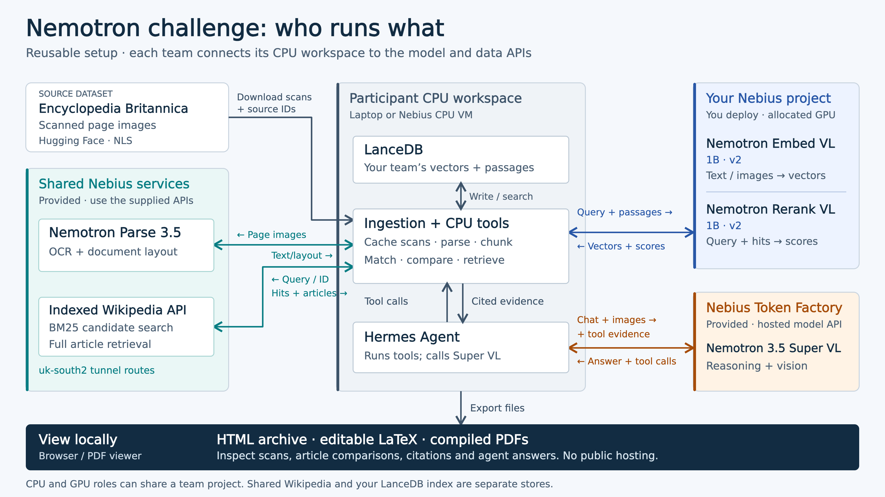
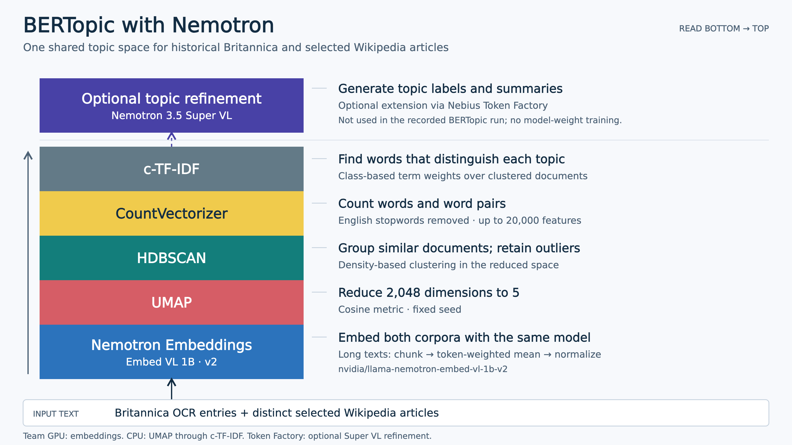

# Nemotron Agentic AI Challenge

Build an agent that compares historical Britannica pages with Wikipedia.
Work with your coding agent to complete the project stages.

This starter supplies setup code, model clients, source data contracts, and checks.
Your team builds the extraction workflow, article matching, comparisons, agent tools, and website.

## Infrastructure

Britannica scans enter your CPU workspace for ingestion and caching.
Your tools call the shared Parse and Wikipedia APIs and your team's GPU services.
Hermes runs in the CPU workspace and calls Super VL through Token Factory.



[Full-size PNG](docs/assets/nebius-participant-infrastructure.png) · [Editable SVG](docs/assets/nebius-participant-infrastructure.svg)

## Prerequisites

| Tool | Version | Needed for |
| --- | --- | --- |
| [uv](https://docs.astral.sh/uv/getting-started/installation/) | 0.12 or later | All stages |
| Python | 3.12 (`>=3.12,<3.14`), pinned in `.python-version` | All stages |
| Git | Any recent version | Clone and branch |
| [tectonic](https://tectonic-typesetting.github.io/en-US/install.html) | Any recent version | Compile LaTeX pages to PDF in `extract` |
| [Hermes Agent](https://hermes-agent.nousresearch.com/docs/getting-started/installation) | Tested with v0.22.1 | `agent` stage |
| Docker with NVIDIA Container Toolkit | CUDA 12.8 driver, Linux amd64 | Embedder and reranker service (see [model service](docs/model-service.md)) |
| `curl`, `jq` | Any recent version | `scripts/check_retrieval.sh` |

You need these accounts and endpoints:

| Service | Who supplies it | `.env` settings |
| --- | --- | --- |
| Parse 3.5 | Organizer (shared URL in `.env.example`) | `PARSE_BASE_URL`, `PARSE_API_KEY` |
| Wikipedia API | Organizer (shared URL in `.env.example`) | `WIKIPEDIA_API_URL` |
| Embedder and reranker | Your team, on Nebius AI Cloud | `RETRIEVAL_BASE_URL`, `RETRIEVAL_API_KEY`, `RETRIEVAL_IMAGE` |
| Super 3.5 VL | Your team, on a separate Nebius Token Factory account | `SUPER_BASE_URL`, `SUPER_MODEL`, `SUPER_API_KEY` |

Without a GPU service and a Token Factory key, you can still run the offline checks, `compare`, `site`, `evaluate`, and `pytest` on the saved artifacts.

## Install

Create your team's repository from this GitHub template.
Clone your repository.
Open a terminal in its root directory.

```sh
uv sync --locked
cp .env.example .env
uv run nemotron-challenge doctor --offline
uv run nemotron-challenge stages
```

`uv sync --locked` creates `.venv` and installs the pinned packages from `uv.lock`.
The offline check tests the starter setup. It does not complete the challenge.
`stages` prints the status of each milestone.

Install tectonic with your package manager, for example `brew install tectonic` on macOS.
The `extract` stage looks for `tectonic` on `PATH` and in `~/.local/bin`.
Without it, the stage writes `.tex` files and skips PDF compilation.

Open this folder in your coding agent.
Ask it to read [AGENTS.md](AGENTS.md).
Choose your first milestone.

## Configure `.env`

Edit `.env`. Git ignores it. Never commit keys.

| Variable | Default | Purpose |
| --- | --- | --- |
| `WIKIPEDIA_API_URL` | Organizer URL | Shared BM25 search and article API |
| `PARSE_BASE_URL` | Organizer URL | Shared Nemotron Parse 3.5 endpoint |
| `PARSE_MODEL` | `nvidia/nemotron-3.5-parse` | Must keep this value |
| `PARSE_API_KEY` | empty | Set it only if the organizer requires a key |
| `RETRIEVAL_BASE_URL` | `http://127.0.0.1:8000/v1` | Your embedder and reranker service |
| `RETRIEVAL_API_KEY` | empty | Bearer token, if a proxy needs one |
| `RETRIEVAL_IMAGE` | empty | Docker image tag or digest that you run |
| `SUPER_BASE_URL` | `https://api.tokenfactory.nebius.com/v1` | Token Factory endpoint |
| `SUPER_MODEL` | `nvidia/Nemotron-3.5-Super-VL` | Must keep this value |
| `SUPER_API_KEY` | empty | Your Token Factory key |
| `CHALLENGE_DB_PATH` | `data/team.lancedb` | LanceDB evidence index |

The loader in [`config.py`](src/nemotron_challenge/config.py) rejects a changed `PARSE_MODEL` or `SUPER_MODEL`.

## Get the source scans

```sh
uv run nemotron-challenge data show
uv run nemotron-challenge data fetch
```

All teams use the same 100 scans and source checksums.
The first fetch downloads a pinned Parquet file of about 357 MiB.
The loader writes the selected scans to `data/raw/britannica`.
It leaves the source cache unchanged.

Use the shared [Wikipedia API](docs/wikipedia-api.md) to search the pinned English Wikipedia snapshot.
Teams do not need to download or build that index.

### Why Wikipedia is pre-indexed

The organizer has built a BM25 keyword index over 7,182,883 canonical English articles from a fixed snapshot.
This saves each team the download, storage, and index-building work for that corpus.
All teams search the same source revision.
Search makes no embedding or reasoning model calls.

Participants use it as follows:

1. Extract a Britannica entry with Parse 3.5.
2. Search terms from the entry to get candidate article IDs and excerpts.
3. Fetch candidate article text through the paginated article API.
4. Use Nemotron embeddings and reranking to assess candidates and decide whether a match is supported.
5. Cache the selected text and source metadata for comparisons and agent evidence.

The shared index supplies candidates, not verified Britannica matches.
Your team's LanceDB index holds its chosen evidence and vectors, separate from the shared keyword index.
Read the [API guide](docs/wikipedia-api.md) for client calls, pagination, and citation metadata.

### Multimodal matching concept

This illustration uses Wikipedia article text as a query to find Britannica page scans about the same subject.
Nemotron Embedder VL encodes the scans, with optional extracted text, into page vectors.
It encodes the article title and selected excerpt into a query vector.
Similarity search returns a shortlist of page IDs.
Nemotron Reranker VL then reads the query text with each original candidate page and ranks the results.


[Full-size PNG](docs/assets/nemotron-vl-matching.png)

The challenge starts from Britannica entries and searches Wikipedia through the shared API.
The diagram reverses that direction to explain the models' text and image inputs.
Your team chooses its matching method and checks each selected association against both sources.
The page examples are illustrative. Relevance scores do not establish factual agreement or identical coverage.
See the [Embed VL model card](https://huggingface.co/nvidia/llama-nemotron-embed-vl-1b-v2) and [Rerank VL model card](https://huggingface.co/nvidia/llama-nemotron-rerank-vl-1b-v2) for the model contracts.

## Set up the models

The organizer supplies Parse 3.5 and the Wikipedia API.

### Embedder and reranker

Deploy the embedder and reranker in your Nebius AI Cloud project.
Use the [Docker recipe](docs/model-service.md) or an organizer-provided image.

```sh
docker buildx build --platform linux/amd64 --load \
  -t nemotron-challenge-models:local infra/model-service
export RETRIEVAL_IMAGE=nemotron-challenge-models:local
docker run --rm --name nemotron-models --gpus device=0 \
  --read-only --tmpfs /tmp:rw,nosuid,nodev,size=1g \
  --cap-drop ALL --security-opt no-new-privileges \
  -p 127.0.0.1:8000:8000 "$RETRIEVAL_IMAGE"
```

The build needs about 60 GB of free disk space.
Set `RETRIEVAL_BASE_URL` in `.env` to the URL of your service.
Check it with `sh scripts/check_retrieval.sh`.

### Super 3.5 VL

Create a separate Nebius Token Factory account.
Follow the [Super VL guide](docs/super-vl.md) to add your key.

```sh
uv run python scripts/check_super.py
```

### Hermes

Install Hermes Agent with the [official instructions](https://hermes-agent.nousresearch.com/docs/getting-started/installation).
Then create the challenge profile and install the plugin:

```sh
sh scripts/setup_hermes.sh
```

The script writes the profile to `data/hermes`.
Keep that folder out of Git.
Read the [Hermes guide](docs/hermes.md) for the profile, plugin, and tools-off runs.

### Check all services

```sh
uv run nemotron-challenge doctor --live
```

The live check tests service access and model catalogs.
Read its output for missing settings and test limits.

## Build your solution

Follow the [milestones](docs/milestones.md).
Each stage has a guide: [match](docs/match.md), [agent](docs/agent.md), [evaluate](docs/evaluate.md).
Run the stages in order. Each one reads the artifacts of the stage before it.

```sh
uv run nemotron-challenge run extract
MATCH_TAU=-5 MATCH_DELTA=0.75 uv run nemotron-challenge run match   # calibrated thresholds, see docs/match.md
uv run nemotron-challenge run compare
uv run nemotron-challenge run agent      # needs SUPER_API_KEY; reads artifacts/agent/questions.jsonl
uv run nemotron-challenge run site
uv run nemotron-challenge run evaluate
```

Label agent runs before you evaluate: `uv run python scripts/label_runs.py <run_id> success|failure "reason"`.

| Stage | Needs | Writes |
| --- | --- | --- |
| `extract` | `data fetch`, Parse endpoint | `artifacts/extract/` (`entries.jsonl`, `pages.jsonl`, `coverage.json`, `crops/`, `latex/`) |
| `match` | `extract`, Wikipedia API, retrieval service | `artifacts/match/` (`matches.jsonl`, `articles.jsonl`, `report.json`, `cache/`) |
| `compare` | `match` | `artifacts/compare/drift.json`, `artifacts/compare/plots/terms.svg` |
| `agent` | `match`, Hermes, `SUPER_API_KEY` | `artifacts/agent/runs/`, `artifacts/agent/env.json` |
| `site` | `extract`, `match`, `compare`, `agent` | `web/data/*.json`, `web/crops/`, `web/scans/`, `web/latex/` |
| `evaluate` | Labeled agent runs | `artifacts/evaluate/` (`README.md`, `report.json`, `cases/`) |

The article cache in `artifacts/match/cache/` is not in Git.
Run `match` on a clean checkout before `compare` or the agent tools.

### Stage options

Set these variables in the shell for one run.

| Variable | Stage | Effect |
| --- | --- | --- |
| `EXTRACT_LIMIT` | `extract` | Process only the first N scans |
| `EXTRACT_SKIP_LATEX` | `extract` | Set to `1` to skip PDF compilation |
| `MATCH_TAU`, `MATCH_DELTA` | `match` | Rerank threshold and margin |
| `MATCH_LIMIT` | `match` | Process only the first N entries |
| `MATCH_PLATE_IMAGES` | `match` | Set to `1` to rerank plates with their image |
| `MATCH_STORE` | `match` | Set to `0` to skip the LanceDB store |
| `MATCH_REFETCH_ARTICLES` | `match` | Set to `1` to refetch cached articles |
| `MATCH_REDECIDE` | `match` | Set to `1` to apply new thresholds to saved scores |
| `CHALLENGE_AGENT_QIDS` | `agent` | Comma-separated question IDs to run |
| `HERMES_BIN`, `HERMES_HOME` | `agent` | Hermes executable and profile folder |
| `SITE_WEB_DIR`, `SITE_SCANS_DIR` | `site` | Site output folder and scan source folder |

Add `--work-dir PATH` to `run` to change the artifacts folder (default `artifacts`).

### View the website

The `site` stage fills the static `web/` folder.
Serve it on loopback:

```sh
python3 -m http.server --bind 127.0.0.1 --directory web 8080
```

Open `http://127.0.0.1:8080`.
A `file://` URL does not work, because the page loads `data/*.json` with `fetch`.
The `.github/workflows/pages.yml` workflow deploys `web/` to GitHub Pages on a push to `main`.

Read the [challenge brief](docs/challenge.md) for the required models and deliverables.
Use the [submission template](templates/submission.md) to record your results.
Submit a video of 3 to 5 minutes and your solution repository.

### Topic comparison with BERTopic

The illustration shows one method for comparing Britannica entries with selected Wikipedia articles.
It uses Nemotron embeddings for both sources, then UMAP, HDBSCAN, term counts, and c-TF-IDF.
The optional Super VL stage generates topic labels and summaries without training model weights.
Choose your comparison method with your team.



[Full-size PNG](docs/assets/bertopic-nemotron-implementation.png) · [Editable SVG](docs/assets/bertopic-nemotron-implementation.svg)

## Check the foundation

```sh
uv run pytest
```

These tests cover the starter infrastructure and data contracts.
Replace a stage's unfinished-state test when you implement that stage.
Your team must test retrieval quality, citation support, and agent behavior.
Record three successes and three failures from your own runs.

GitHub Actions runs `pytest` and `doctor --offline` on each push.
The model service has its own CPU tests. See [model service](docs/model-service.md#cpu-checks).

## Repository layout

| Path | Contents |
| --- | --- |
| `src/nemotron_challenge/` | CLI, clients, config, stages, match pipeline, agent tools |
| `integrations/hermes/` | Hermes plugin, answer policy (`SOUL.md`), config example |
| `infra/model-service/` | Docker recipe for the embedder and reranker |
| `scripts/` | Live checks, label tools, Hermes setup |
| `templates/` | LaTeX page template, submission and case study templates |
| `docs/` | Guides for each milestone and service |
| `artifacts/` | Saved stage outputs and run records |
| `web/` | Static website |
| `data/` | Local scans, cache, and Hermes profile. Git ignores most of it |
| `tests/` | Unit tests and fixtures |

## Troubleshooting

| Symptom | Action |
| --- | --- |
| `PARSE_MODEL must be ...` | Remove the `PARSE_MODEL` line or set the value from `.env.example`. |
| `doctor --live` reports a missing setting | Set the named variable in `.env`. |
| `match` fails to connect | Start the model service and check `RETRIEVAL_BASE_URL`. Run `sh scripts/check_retrieval.sh`. |
| `429` from the model service | The queue is full. Retry after one second or send fewer items. |
| `agent` cannot find Hermes | Install Hermes or set `HERMES_BIN`. |
| `agent` uses old plugin code | Run `sh scripts/setup_hermes.sh`, then `pkill -f "gateway run"`. |
| Agent tools return `evidence: missing` | Run `match` to rebuild the article cache. |
| Site shows no scans | Run `data fetch`, then `run site`. |
| Site shows no PDFs | Install tectonic and run `extract` again. |
| Browser shows an empty site from `file://` | Serve `web/` with `http.server` as shown above. |

## Licenses

Original starter code uses [MIT](LICENSE).
Data and model weights retain their source licenses.
Read [ATTRIBUTION.md](ATTRIBUTION.md) before you share source material or model artifacts.
